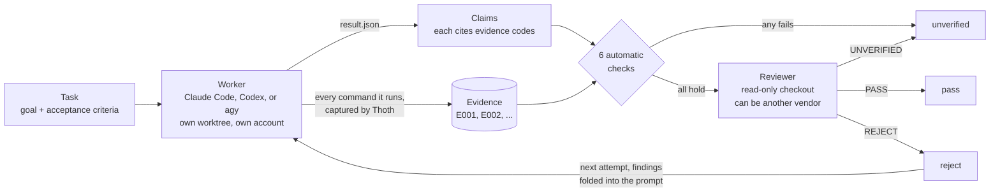

**English** · [繁體中文](README.zh-TW.md)

# Thoth

**Don't take your coding agent's word for it. Look at what it actually ran.**

Thoth is a local control plane for AI coding agents. A **commander**, usually your
own Claude Code session, hands a spec to a **worker**: Claude Code, OpenAI Codex,
or Google Antigravity (`agy`),
the official CLIs, each running in its own git worktree and signed in to its own
subscription account.

Whatever the worker *says* is recorded as a **claim**. Every command it actually
*runs* is recorded next to it as **evidence**, captured by Thoth rather than
reported by the worker. A separate **reviewer**, which can be a different vendor's
model, then judges the claims against that evidence in a read-only checkout. Its
verdict decides whether the task passes, not the worker's summary.

One Rust binary. Local SQLite state. No daemon, no server, no cloud account of its own.

## The problem

> "Implemented the retry, added tests, all tests pass."

How do you know? That sentence comes from the same model that did the work. In
Thoth's own trials, summaries like that looked fine while:

- the spec said "write a failing test first", and the red step had never happened;
- a change quietly overwrote the user's own git exclude rules, and would delete them
  if two dispatches ran at once or a process was killed halfway;
- the claim and the docs said one thing (baseline = start of the task) and the code
  did another (baseline = start of the run);
- tests were piped through `| tail` or `| grep`, so the exit code the agent saw
  belonged to `tail`, not to the test runner.

Reading every diff yourself does not scale, and asking the same agent "are you
sure?" does not help. Thoth separates what the agent said from what it did, and
has someone else judge from what it did.

## How a task flows



1. You write a spec: one goal and a list of acceptance criteria (`AC1: ...`, `AC2: ...`).
2. `thoth dispatch` starts the worker in a fresh git worktree and returns at once.
   A detached runner watches it; your own branch is never touched.
3. While the worker runs, every shell command it executes is captured beside it:
   for Claude Code by a hook, for Codex from Codex's own JSON event stream, and
   for agy from its transcript. Output
   is stored as content-addressed evidence. The worker does not opt in and cannot opt out.
4. The worker finishes by writing its claims, each citing evidence codes. Six
   mechanical checks run on them. If any fails, the task is `unverified`: no model
   is asked for an opinion.
5. A reviewer checks every acceptance criterion against the evidence and must cite
   evidence for each one it calls `met`. `PASS` → `pass`, `REJECT` → `reject`,
   `UNVERIFIED` → `unverified`.
6. After a `reject`, the next `thoth dispatch` starts a new attempt from the rejected
   commit, with the reviewer's findings folded into the worker's prompt.
7. You merge the passing branch yourself. Thoth never merges and never deletes a worktree.

## Why trust it

Thoth was used on 59 real development tasks before release. The tally is computed
by a script from per-task records:

| | |
|---|---|
| Tasks where the reviewer caught at least one real defect | **45 of 59** |
| Real defects caught | 46 important, 128 minor, 4 unlabelled |
| Times the recorded evidence contradicted what the agent said | 6 (in 6 tasks) |
| Tasks rejected and redone at least once | 31 (110 attempts, 138 runs in all) |
| `unverified` outcomes | 6, of which 3 were real problems |
| Runs on a second account or another vendor | 110 |
| Human time, all 59 tasks together | 13 minutes |
| Final status | 58 pass, 1 failed |

There was no control group, and 55 of the 59 tasks were on Thoth's own code. Workers
and reviewers ran on Claude Code and Codex; the only two agy runs tried both
stopped early. The caveats, the examples and what the numbers do not show are in
**[docs/field-results.md](docs/field-results.md)**.

## Quick start

### 1. Install

Windows (64-bit x64, PowerShell 5.1 or newer):

```powershell
irm https://raw.githubusercontent.com/johnny-lo/Thoth/master/install.ps1 | iex
```

Linux (x86_64, glibc 2.39 or newer; releases are built on Ubuntu 24.04):

```sh
curl -fsSL https://raw.githubusercontent.com/johnny-lo/Thoth/master/install.sh | sh
```

These install into `~/.local/bin` (`%USERPROFILE%\.local\bin` on Windows),
verify SHA256SUMS, and start `thoth setup` when a terminal is available. Run the
same command again to upgrade. Windows adds the directory to your user PATH;
Linux prints the line to add to your shell profile. Without a terminal, run
`thoth setup` yourself afterwards.

Executables are unsigned; the installers verify SHA-256. Installing from a
terminal does not trigger SmartScreen; downloading the executable from the
Releases page in a browser can trigger a warning.

Optional environment variables (set before running the command):

- `THOTH_INSTALL_VERSION`: select a `vX.Y.Z` release tag instead of latest.
- `THOTH_INSTALL_DIR`: choose an installation directory instead of `~/.local/bin`.
- `THOTH_INSTALL_NO_SETUP`: set to `1` to skip setup and run it yourself later.
- `THOTH_INSTALL_BASE_URL`: override the releases URL or use a local directory with `latest/download/` and `download/vX.Y.Z/` assets and SHA256SUMS for offline testing.

Alternatively, install from source (Rust 1.95 or newer). macOS and other
platforms must use this method:

```
cargo install --git https://github.com/johnny-lo/Thoth --locked --bin thoth
```

`--bin thoth` leaves out the test doubles the package also builds (`fake-claude`,
`fake-codex`, `fake-agy`, `fake-mcp`, `fake-curl`). Thoth is not on crates.io (the name there
belongs to an unrelated crate).

You also need `git`, plus the worker CLI you want to use: Claude Code (`claude`),
Codex (`codex`), and/or Google Antigravity (`agy`), installed the normal way.

### 2. Register a worker account

Each worker account gets its own config directory, which you create and log in to
yourself, once. Never point a profile at your own `~/.claude` or `~/.codex`: the
worker writes session files there, and would load your personal settings, hooks
and plugins.

Run this block in a POSIX shell (Linux, or Git Bash / WSL on Windows); the
PowerShell equivalent follows it.

```bash
# Claude Code
mkdir -p ~/.thoth/profiles/claude-1
CLAUDE_CONFIG_DIR=~/.thoth/profiles/claude-1 claude      # log in, then /exit
thoth profile add claude-1 --provider anthropic --harness claude-code --config-dir ~/.thoth/profiles/claude-1
thoth profile check claude-1

# Codex
mkdir -p ~/.thoth/profiles/codex-1
CODEX_HOME=~/.thoth/profiles/codex-1 codex login        # log in with your ChatGPT account
thoth profile add codex-1 --provider openai --harness codex --config-dir ~/.thoth/profiles/codex-1
thoth profile check codex-1

# Google Antigravity: sign in to agy as usual; its login is per machine user
thoth profile add agy-1 --provider google --harness antigravity --config-dir ~/.gemini/antigravity-cli
thoth profile check agy-1
```

On Windows PowerShell: `New-Item -ItemType Directory -Force "$HOME\.thoth\profiles\claude-1"`,
then `$env:CLAUDE_CONFIG_DIR = "$HOME\.thoth\profiles\claude-1"; claude`,
then `Remove-Item Env:\CLAUDE_CONFIG_DIR` after you exit.

### 3. Run a task

`spec.json`:

```json
{
  "goal": "Add a retry to the uploader",
  "acceptance_criteria": ["AC1: retries three times", "AC2: logs each attempt"],
  "constraints": ["Write the failing test first", "No new dependencies"],
  "non_goals": ["Rewriting the transport"],
  "risk": "normal"
}
```

From the root of the repository you want work done in:

```bash
thoth setup                                  # guided: accounts, this repo, checks, plugin (asks first)
thoth init                                   # once per repository
thoth checks add test --cmd "cargo test"     # once: a check Thoth may re-run (your own test command)
thoth checks approve                         # approve it (your commander does this with --reason)
thoth doctor                                 # read-only health check
thoth task create -f spec.json --title "uploader retry"
thoth dispatch TASK_ID --profile claude-1 --model sonnet --timeout 30m
thoth wait TASK_ID --timeout 30m             # returns when the task is ready for review
thoth evidence list TASK_ID                  # what the worker actually ran
thoth verify RUN_ID                          # Thoth re-runs the approved checks itself
thoth review start TASK_ID --profile codex-1 --model gpt-5.6-luna --json
thoth wait --run REVIEW_RUN_ID --timeout 30m # the verdict
thoth review show TASK_ID
```

`thoth doctor` changes nothing. It checks the state directory, the three CLIs, every
profile's login, this repository and its checks, and the Claude Code plugin, and
prints a fix command, written for your shell, for anything that is wrong
(`THOTH_LANG=zh-TW` prints it in Traditional Chinese). `RUN_ID` is the implementer
run that `dispatch` printed; `thoth status TASK_ID` lists it too.

IDs accept any unique prefix of 6 or more characters. Every command except
`thoth mcp` and `thoth setup` takes `--json`.

## Using Thoth from Claude Code

The intended commander is an agent, not a person typing commands. Install the
Claude Code plugin:

```
claude plugin marketplace add johnny-lo/Thoth
claude plugin install thoth@thoth
```

It adds the skill `thoth-dispatch`, which teaches your Claude Code session the
whole loop: write the spec, dispatch, wait, read the review packet, judge from
evidence only, record the verdict, and handle rework, interruptions and
`unverified`. It also adds an MCP server (`thoth mcp`) with 32 tools for the same
commands. The `thoth` executable must be on your `PATH`. Details:
[docs/mcp.md](docs/mcp.md).

Once it is installed, type `/thoth` for a panel with this repository's tasks, each account's quota, and notifications; it can also open a view of what each task's worker is doing.

Codex, other MCP clients and tools without MCP can drive Thoth the same way, through
`thoth mcp` or `thoth guide`: see [docs/integrations.md](docs/integrations.md).
Everything the skill relies on (commands, flags, exit codes, `--json` keys) is
written down as an interface contract:
[docs/adapter-usage.md](docs/adapter-usage.md).

## How it works

**Claims are not facts.** The worker ends by writing `.agent/result.json`: its
claims (`test_result`, `doc_reference`, `behavior`, `completion`,
`protected_change`), each citing evidence codes such as `E004`. Claims and evidence
are separate records. A claim with nothing behind it is an assertion, not a finding.

**Evidence is collected beside the worker, not by it.** For Claude Code, a hook
records each command and its complete output. For Codex, each finished command in
its `--json` event stream becomes a record; for agy, command exit codes come from
its transcript. The diff and the candidate commit are
recorded too. Output is stored by SHA-256, append-only, and re-hashed every time it
is read. The worker gets a generated index of codes to cite and never edits it.

**Six automatic reasons for `unverified`**, checked before anything is written:

| rule | the task goes `unverified` when |
|---|---|
| 1 | `result.json` fails schema validation |
| 2 | a `test_result` or `doc_reference` claim cites nothing |
| 3 | a claim cites a code that is not evidence of this task |
| 4 | cited evidence is missing, or no longer matches its recorded hash |
| 5 | the task is `risk: high` and a claim cites no evidence recorded by Thoth |
| 6 | the diff modified or deleted an existing test file or a check's input file (or added a file named like a word of a check's command) and no `protected_change` claim declares it |

**The reviewer works in a read-only checkout.** `thoth review start` checks out the
candidate commit detached, so the reviewer cannot see uncommitted work or move a
branch. A Claude Code reviewer gets no `Write` or `Edit` tool; a Codex reviewer runs
in Codex's read-only sandbox; an Antigravity reviewer gets no shell or write tools.
Reviewers can be selected across all three providers. Every criterion must be judged exactly once, every `met` must cite
evidence, and a `PASS` with any `unmet` criterion is invalid. An invalid review
never becomes a `pass`. `thoth review show` also warns when a reviewer cited
evidence it never opened. Prefer your own reviewer? `thoth review packet` prints
the spec, evidence index, output tails, full diffs and claims in one document,
leaving out the worker's own summary on purpose, and `thoth review record` files
the verdict under the same rules.

**Rework keeps the work, not the conversation.** A `reject` makes the next dispatch
a new attempt, branched from the rejected commit. The reviewer's unmet criteria and
findings go into the worker's prompt, and the worker is asked to show a failing
test first for each finding that changes behaviour. Attempts are capped (default 2).
At `important` or `high` risk, findings are not folded in automatically: you rewrite
the spec first (`thoth task update-spec`), and `thoth dispatch` refuses until you do.
When the same reason comes back in three rejections in a row, `dispatch` refuses
until you rewrite the spec or close the task.

**`thoth verify` re-runs the checks itself, and only approved checks.**
Each repository has a catalogue of checks (`thoth checks add test --cmd "cargo test"`).
A commander agent may propose one and approve it, always with a reason
(`thoth checks approve --reason "..."`, or the MCP tool `thoth_checks_approve`); a
worker can do neither. You can also approve in a terminal. Approving pins the
command, the executable and its input files by hash, and every approval, who made
it and the reason are shown to the reviewer. `verify` runs
the approved checks in Thoth's own process, in the run's worktree, and records the
results as new evidence. A check whose pinned files have changed is refused, and
no command a worker declared is ever run. `--at-base` runs the same checks at the task's
starting commit, so a reviewer can tell "already failing before the worker started"
from "broken by this change". `--dry-run` shows the checks without running them.

**Workers get a narrow toolset.** A Claude Code worker gets only the tools you list
(default `Bash,Read,Write,Edit,Glob,Grep`) and no MCP servers, so no subagents, no
web browsing and none of your connectors. A Codex worker runs with multi-agent,
apps, browser use and computer use disabled, and ignores the profile's own config
file. An agy worker's tool list is enforced by a PreToolUse hook; with command
execution allowed, that lock is a guard rail rather than a sandbox. Thoth records
which models each run used and whether it spawned subagents.

**Accounts and quota.** `thoth profile usage` shows how much of each account's
quota is left (five-hour and weekly windows), as last written to disk by Claude
Code, Codex, or agy themselves. For agy, Codex and Claude Code, `thoth profile usage --refresh`
asks agy, the codex CLI's app-server, and Claude Code (claude's own `/usage`
command) for a live reading, once you have turned
that on with `thoth config set live-quota on`. With it on, `thoth recommend`
also asks, before it ranks, for each agy or Codex account whose
reading is more than 10 minutes old; a failed ask only prints a warning.
`thoth recommend --role implementer|reviewer` lists every account's quota facts
and does not choose for you: accounts at 95% or more of a window that has not
reset yet are marked not eligible, with the reason; for a reviewer, an account
from a different vendor than the implementer's comes first; then idle accounts
come before busy ones. Thoth never opens
credentials. If a worker's account reaches its quota mid-task, the run is marked
`interrupted`; `thoth status TASK` lists the accounts that still have quota to
dispatch again to, or it can be continued later with `thoth resume`.

**You choose; Thoth records.** Thoth does not pick the account, model or effort
for you: the first dispatch gives `--profile`, `--model` and `--effort`, and a
re-dispatch in the same attempt keeps the previous run's model and effort.
`--effort low|medium|high|xhigh|max|ultra` is passed
to the CLI as its own setting, lowered to what the model supports (agy has none). Every launch
is recorded with what was chosen and, with `--reason`, why.

**Models.** `thoth models` lists the models each account can use, with Thoth's own
record for each: implementer runs, reviewed runs, `PASS` and `REJECT` counts. With
`thoth models --refresh` and your own free API key from
[AI Stupid Level](https://aistupidlevel.info) in `AISTUPIDLEVEL_API_KEY`, from
[Artificial Analysis](https://artificialanalysis.ai) in `ARTIFICIALANALYSIS_API_KEY`,
or both (or stored once with `thoth config set-secret`, typed at a hidden prompt,
never shown again), it also shows their public benchmark scores; AI Stupid Level's also mark
models that may have degraded. Scores are always shown with their source.
`models --refresh` is the only command with which Thoth itself uses the network
(`profile usage --refresh` has agy, codex and claude each do it; with
`live-quota` on, `recommend` has only agy and codex do
it).

**Status page.** `thoth report` writes one self-contained, read-only HTML page:
every account's quota and work, the dispatch decision table (which model at
which effort did what, how often it passed, what it cost) and every launch's
choice, reason and outcome, every task by repository, and what `REJECT`
and `unverified` reviews caught. Once it exists, it is rewritten after every command
that changes a task. The page is currently in Traditional Chinese.

State lives in `~/.thoth` (`%USERPROFILE%\.thoth` on Windows), or `THOTH_HOME` if
set, never inside your repository. `THOTH_CLAUDE_BIN`, `THOTH_CODEX_BIN`, and
`THOTH_AGY_BIN` choose which `claude`, `codex`, and `agy` executables are launched.

## Commands

| command | what it does |
|---|---|
| `thoth init` | register the current git repository (once) |
| `thoth setup` | set up accounts, this repository, checks and the plugin step by step, asking first |
| `thoth doctor` | check this machine's setup without changing anything |
| `thoth profile add / list / check / usage` | worker accounts: register, list, confirm login, quota left |
| `thoth recommend --role implementer\|reviewer` | every account's quota facts, eligible or not and why; it does not choose for you |
| `thoth task create / show / update-spec / close` | create a task from a spec, inspect, rewrite the spec, abandon |
| `thoth dispatch TASK` | start (or restart) an implementer run on the account, model and effort you give |
| `thoth wait TASK` / `thoth wait --run RUN` | block until a task needs you, or until a run ends (exit `3` on timeout) |
| `thoth status [TASK]` | open tasks, or one task with its runs |
| `thoth events --since N` | event log with a cursor, for polling agents |
| `thoth evidence list / show` | evidence index; one record with its stored output |
| `thoth checks add / approve / list / remove` | the checks `verify` may run; the commander approves with a reason (MCP too), you can in a terminal, and the reviewer sees each approval and its reason |
| `thoth verify RUN [--at-base] [--dry-run]` | Thoth re-runs the approved checks |
| `thoth review start / show / packet / record` | independent reviewer; its findings; one-document packet; file an outside review |
| `thoth resume RUN` / `thoth cancel RUN` | continue an interrupted run; stop a live one |
| `thoth submit` | file a corrected `result.json` by hand |
| `thoth decision add` | append a decision to the repository's decision log |
| `thoth report [--open]` | write the HTML status page |
| `thoth models [--refresh]` | models per account, Thoth's record, public scores |
| `thoth config list / get / set / unset / set-secret` | every setting with its source: the three switches, the language, the three CLI paths, the live-quota timeout, the two score URLs and the two score API keys (stored, never displayed) |
| `thoth guide` / `thoth mcp` | print the commander guide; serve the commands as MCP tools |

Full reference: [docs/phase1/usage.md](docs/phase1/usage.md) (setup, dispatch,
quota interruptions, `doctor`) and [docs/phase2/usage.md](docs/phase2/usage.md)
(evidence, review, rework, checks, Codex and agy workers, automatic dispatch).
Design: [docs/design.md](docs/design.md).

## Supported platforms and workers

| | |
|---|---|
| Windows x64 | supported |
| Linux x64 | supported, with a systemd user session (every run is a transient `systemd-run --user` service; containers, minimal servers and some WSL setups lack one) |
| macOS | **not supported yet.** It needs its own process control. If you want it, say so in an issue |

| worker | implementer | reviewer | how commands are captured |
|---|---|---|---|
| Claude Code (`claude`) | yes | yes | a Claude Code hook |
| OpenAI Codex (`codex`) | yes | yes | Codex's own `--json` event stream |
| Google Antigravity (`agy`) | yes | yes | agy's transcript and PreToolUse hook |

Dispatching to agy always requires an agy model. One machine user has one agy
account, and Thoth runs share that account's quota with the user's own agy sessions.

## Terms of service

Thoth starts other companies' CLIs on your behalf, and is built to stay inside their terms:

- It only launches the official, unmodified CLIs (`claude`, `codex`, `agy`) that you installed.
- It never reads, stores or forwards credentials or OAuth tokens. A profile stores
  only the path of a config directory. Login status comes from the CLIs' own status
  commands, and quota figures from files the CLIs already wrote or, for agy,
  codex and Claude Code when you turn it on, from agy's own `/usage` command,
  codex's own app-server and Claude Code's own `/usage` command (all asked on
  `profile usage --refresh`; agy and codex also by `recommend`
  when a reading is more than 10 minutes old, Claude Code
  only on `profile usage --refresh`).
- Every account is logged in by you, yourself, once per profile.
- It is for the account holder's own use. Do not share your accounts with other
  people through it, and do not resell access.
- You are responsible for following each provider's terms:
  [Anthropic (Claude Code)](https://code.claude.com/docs/en/legal-and-compliance),
  [OpenAI](https://openai.com/policies/terms-of-use/), and
  [Google Antigravity](https://antigravity.google/terms).
- Before you use `agy` through Thoth, check Google's terms yourself.

## Security

**Workers are not sandboxed by Thoth.** A Claude Code worker can reach the whole
filesystem, including the `.git/hooks` directory shared by every worktree. (Codex
applies its own workspace-write mode; agy's tool lock is a guard rail, not a
sandbox; Thoth adds nothing on top.) Dispatch only
work you would be willing to run yourself.

Evidence marked as collected by Thoth protects against a worker that is confused,
over-optimistic or sloppy. It is not a defence against a hostile worker, which
could forge input to the capture channel. `thoth verify` does not depend on the
worker at all: Thoth runs the approved checks in its own process. Approve only
check commands you have read.

What Thoth stores on this machine is kept as it was. Content handed to another
vendor's model or to the commander has whatever looks like a key masked first.
A worker does not get Thoth's own key variables, and a spec that holds a
secret is refused. The limits are listed under "Secret masking" in
[docs/phase2/usage.md](docs/phase2/usage.md).

To report a vulnerability privately, see [SECURITY.md](SECURITY.md).

## Development

```
cargo test
cargo clippy --all-targets -- -D warnings
```

The test suite never calls a real `claude`, `codex` or `agy`. It runs the test
doubles in `src/bin/` against throwaway git repositories. The design is summarised in
[docs/design.md](docs/design.md).

## License

Licensed under either of [Apache License, Version 2.0](LICENSE-APACHE) or
[MIT license](LICENSE-MIT), at your option.

Unless you explicitly state otherwise, any contribution intentionally submitted for
inclusion in this project by you, as defined in the Apache-2.0 license, shall be
dual licensed as above, without any additional terms or conditions.

*The name: Thoth is the Egyptian god of writing, the scribe who records the verdict.*
