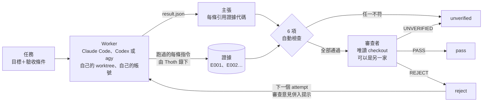

[English](README.md) · **繁體中文**

# Thoth

**別只聽 AI 寫程式時怎麼說，要看它實際跑了什麼。**

Thoth 是在你自己電腦上執行的 AI coding agent 控制層。**指揮官**（通常是你自己的
Claude Code session）把規格交給 **worker**：Claude Code、OpenAI Codex 或 Google
Antigravity（`agy`）的官方
CLI，每個 worker 都在自己的 git worktree 裡、用自己的訂閱帳號執行。

worker **說**的話，一律記成「主張」（claim）。它實際**跑**的每一條指令，由 Thoth
在旁邊錄下來，存成「證據」（evidence），不是讓 worker 自己回報。接著由另一個
**審查者**在唯讀的 checkout 裡，拿證據逐條核對主張；審查者可以是另一家的模型。
任務過不過關看審查的判決，不看 worker 寫的總結。

一個 Rust 執行檔，狀態存在本機的 SQLite。不需要常駐服務、不需要伺服器，也沒有
自己的雲端帳號。

## 它解決什麼問題

> 「重試機制做好了，也補了測試，全部測試通過。」

你怎麼知道是真的？這句話出自做事的同一個模型。在 Thoth 自己的試用裡，總結看起來
都沒問題，實際上卻是：

- 規格要求「先寫會失敗的測試」，紅燈那一步根本沒做；
- 改動悄悄覆寫了使用者自己的 git exclude 規則，兩次派工同時跑、或行程被砍在半途，
  規則就會被刪掉；
- 主張和文件說基準線是「任務的起點」，程式實際用的卻是「這次 run 的起點」；
- 測試被接進 `| tail` 或 `| grep`，agent 看到的結束碼是 `tail` 的，不是測試本身的。

每個 diff 都自己讀，量一大就讀不完；再問同一個 agent「你確定嗎？」也沒用。Thoth
把 agent 說了什麼和做了什麼分開，再請別人根據它做了什麼來判斷。

## 一件任務怎麼跑



1. 你寫一份規格：一個目標，加上一串驗收條件（`AC1: ...`、`AC2: ...`）。
2. `thoth dispatch` 在一個全新的 git worktree 裡啟動 worker，指令馬上返回，由背景
   的 runner 看著它。你自己的分支完全不會被動到。
3. worker 執行時，它跑的每條 shell 指令都在旁邊被錄下：Claude Code 靠 hook，Codex
   靠 Codex 自己的 JSON 事件流，agy 靠自己的 transcript。輸出依內容雜湊存成證據。worker 不需要配合，也關不掉。
4. worker 最後寫出它的主張，每一條都要引用證據代碼。這些主張要先過 6 項機械檢查，
   任一項不符，任務就是 `unverified`，完全不經過任何模型的判斷。
5. 審查者拿證據逐條核對驗收條件，判定 `met` 的每一條都必須引用證據。
   `PASS` → `pass`，`REJECT` → `reject`，`UNVERIFIED` → `unverified`。
6. 被 `reject` 之後，下一次 `thoth dispatch` 會從被退件的 commit 開一個新的
   attempt，審查意見自動併進 worker 的提示。
7. 過關的分支由你自己合併。Thoth 不會幫你合併，也不會刪 worktree。

## 為什麼可信

正式公開前，Thoth 已經用在 59 件真實的開發任務上。以下數字由腳本從每件任務的紀錄統計：

| | |
|---|---|
| 審查者至少抓到一個真缺陷的任務 | **59 件中有 45 件** |
| 抓到的真缺陷 | 重要 46、小 128、未分級 4 |
| 錄下的證據推翻 agent 說法的次數 | 6 次（出現在 6 件） |
| 至少被退件重做一次的任務 | 31 件（合計 110 個 attempt、138 個 run） |
| `unverified` | 6 次，其中 3 次是真問題 |
| 跑在第二個帳號或另一家的 run | 110 個 |
| 人工時間（59 件合計） | 13 分鐘 |
| 最終狀態 | pass 58 件、failed 1 件 |

這批數字沒有對照組，而且 59 件裡有 55 件是 Thoth 自己的程式。worker 和審查者跑在
Claude Code 與 Codex 上；僅有的兩個 agy run 都提早停了。限制、具體例子，以及
這些數字**沒有**證明什麼，都寫在 **[docs/field-results.md](docs/field-results.md)**（英文）。

## 快速開始

### 1. 安裝

Windows（64 位元 x64，PowerShell 5.1 以上）：

```powershell
irm https://raw.githubusercontent.com/johnny-lo/Thoth/master/install.ps1 | iex
```

Linux（x86_64、glibc 2.39 以上；Releases 在 Ubuntu 24.04 編譯）：

```sh
curl -fsSL https://raw.githubusercontent.com/johnny-lo/Thoth/master/install.sh | sh
```

腳本裝到 `~/.local/bin`（Windows 是 `%USERPROFILE%\.local\bin`），驗證 SHA256SUMS，
有終端機時接著跑 `thoth setup`。重跑同一行就是升級。Windows 會補上使用者 PATH，
PATH 裡原有的 `%VAR%` 項目保持原樣；PATH 已經用別種寫法（8.3 短檔名、大小寫不同、
結尾斜線、引號或 `%VAR%` 形式）列了這個資料夾時不會重複加入；
Linux 會印出要加進 shell 設定檔的那一行。沒有終端機時，之後自行執行 `thoth setup`。

執行檔沒有簽章，安裝腳本用 SHA-256 驗證。從終端機安裝不會跳 SmartScreen；
用瀏覽器下載 Releases 頁的執行檔才會出現警告。

可選環境變數（執行安裝指令前設定）：

- `THOTH_INSTALL_VERSION`：指定 `vX.Y.Z` release tag，未設時裝最新版。
- `THOTH_INSTALL_DIR`：指定安裝資料夾，預設 `~/.local/bin`。
- `THOTH_INSTALL_NO_SETUP`：設成 `1` 跳過 setup，之後自行執行。
- `THOTH_INSTALL_BASE_URL`：覆寫 releases 網址，或指定含 `latest/download/` 與 `download/vX.Y.Z/` 資產、SHA256SUMS 的本機資料夾做離線測試。

第二種方法是從原始碼安裝（需要 Rust 1.95 以上）；macOS 與其他平台只用這個方法：

```
cargo install --git https://github.com/johnny-lo/Thoth --locked --bin thoth
```

`--bin thoth` 讓它只裝 `thoth`，不裝這個套件同時編出的測試替身（`fake-claude`、
`fake-codex`、`fake-agy`、`fake-mcp`、`fake-curl`）。Thoth 不在 crates.io 上（那裡的同名套件是別的專案）。

另外需要 `git`，以及你要用的 worker CLI：Claude Code（`claude`）、Codex
（`codex`）或 Google Antigravity（`agy`），照官方方式安裝即可。

### 2. 登記 worker 帳號

每個 worker 帳號都有自己的設定資料夾，由你自己建立、自己登入一次。**不要**把
profile 指到你平常用的 `~/.claude` 或 `~/.codex`：worker 會往裡面寫 session 檔，
也會載入你個人的設定、hook 和外掛。

下面這段請在 POSIX shell 裡執行（Linux，或 Windows 上的 Git Bash／WSL）；PowerShell
的寫法接在後面。

```bash
# Claude Code
mkdir -p ~/.thoth/profiles/claude-1
CLAUDE_CONFIG_DIR=~/.thoth/profiles/claude-1 claude      # 登入後輸入 /exit 離開
thoth profile add claude-1 --provider anthropic --harness claude-code --config-dir ~/.thoth/profiles/claude-1
thoth profile check claude-1

# Codex
mkdir -p ~/.thoth/profiles/codex-1
CODEX_HOME=~/.thoth/profiles/codex-1 codex login        # 用你的 ChatGPT 帳號登入
thoth profile add codex-1 --provider openai --harness codex --config-dir ~/.thoth/profiles/codex-1
thoth profile check codex-1

# Google Antigravity：照平常方式登入 agy；一個機器使用者只有一份 agy 登入
thoth profile add agy-1 --provider google --harness antigravity --config-dir ~/.gemini/antigravity-cli
thoth profile check agy-1
```

Windows PowerShell：先 `New-Item -ItemType Directory -Force "$HOME\.thoth\profiles\claude-1"`，
再 `$env:CLAUDE_CONFIG_DIR = "$HOME\.thoth\profiles\claude-1"; claude`，
離開後再執行 `Remove-Item Env:\CLAUDE_CONFIG_DIR`。

### 3. 跑一件任務

`spec.json`：

```json
{
  "goal": "Add a retry to the uploader",
  "acceptance_criteria": ["AC1: retries three times", "AC2: logs each attempt"],
  "constraints": ["Write the failing test first", "No new dependencies"],
  "non_goals": ["Rewriting the transport"],
  "risk": "normal"
}
```

在你要做事的 repo 根目錄：

```bash
thoth setup                                  # 一步一步設定：帳號、這個 repo、檢查、插件（每步先問）
thoth init                                   # 每個 repo 做一次
thoth checks add test --cmd "cargo test"     # 做一次：Thoth 可以重跑的檢查（換成你自己的測試指令）
thoth checks approve                         # 核准（指揮官會帶 --reason 做這步）
thoth doctor                                 # 唯讀的健康檢查
thoth task create -f spec.json --title "uploader retry"
thoth dispatch TASK_ID --profile claude-1 --model sonnet --timeout 30m
thoth wait TASK_ID --timeout 30m             # 任務可以審查時返回
thoth evidence list TASK_ID                  # worker 實際跑了什麼
thoth verify RUN_ID                          # Thoth 自己重跑核准過的檢查
thoth review start TASK_ID --profile codex-1 --model gpt-5.6-luna --json
thoth wait --run REVIEW_RUN_ID --timeout 30m # 等判決
thoth review show TASK_ID
```

`thoth doctor` 什麼都不改。它檢查狀態資料夾、三個 CLI、每個 profile 的登入、這個
repo 和它的檢查，以及 Claude Code 外掛；哪一項不對，就印出照你的 shell 寫好的修正
指令（設 `THOTH_LANG=zh-TW` 會用繁體中文顯示）。`RUN_ID` 是 `dispatch` 印出的實作
run；`thoth status TASK_ID` 也會列出來。

ID 可以只打前 6 個字元以上、不重複的前綴。除了 `thoth mcp` 與 `thoth setup`，每個指令都支援 `--json`。

## 從 Claude Code 使用

Thoth 設計上的指揮官是 agent，不是手動打指令的人。安裝 Claude Code 外掛：

```
claude plugin marketplace add johnny-lo/Thoth
claude plugin install thoth@thoth
```

它會加入 skill `thoth-dispatch`，教你的 Claude Code session 走完整個流程：寫規格、
派工、等待、讀審查資料包、只根據證據判斷、記下判決，以及處理退件重做、中斷與
`unverified`。它也會加入一個 MCP server（`thoth mcp`），用 32 個工具提供同樣的指令。
`thoth` 執行檔要在 `PATH` 上。細節見 [docs/mcp.md](docs/mcp.md)。

安裝後打 `/thoth` 就有面板：這個 repo 的任務、每個帳號的額度，以及通知；也能點開看每件任務的 worker 正在做什麼。

Codex、其他 MCP client，以及不支援 MCP 的工具，也能透過 `thoth mcp` 或
`thoth guide` 用同樣的方式呼叫 Thoth：見 [docs/integrations.md](docs/integrations.md)。
skill 依賴的所有東西（指令、參數、結束碼、`--json` 欄位）都寫成了介面契約：
[docs/adapter-usage.md](docs/adapter-usage.md)。

## 運作方式

**主張不是事實。** worker 最後寫出 `.agent/result.json`，裡面是它的主張
（`test_result`、`doc_reference`、`behavior`、`completion`、`protected_change`），每一條引用 `E004`
這類證據代碼。主張和證據是分開的紀錄；沒有證據撐腰的主張只是說法，不是發現。

**證據在 worker 旁邊採集，不由 worker 提供。** Claude Code 由 hook 記下每條指令和
完整輸出；Codex 則是 `--json` 事件流裡每一條完成的指令變成一筆紀錄；agy 從自己的
transcript 取得指令結束碼。diff 和候選
commit 也會記下。輸出以 SHA-256 存放、只增不改，每次讀取都重新驗證雜湊。worker
拿到的是 Thoth 產生的代碼索引，只能引用、不能修改。

**6 個自動判成 `unverified` 的條件**，在寫入任何東西之前檢查：

| 規則 | 符合時任務變成 `unverified` |
|---|---|
| 1 | `result.json` 不符合格式 |
| 2 | `test_result` 或 `doc_reference` 類的主張沒有引用任何證據 |
| 3 | 主張引用的代碼不是這件任務的證據 |
| 4 | 引用的證據不見了，或雜湊和當初記錄的不一致 |
| 5 | 任務是 `risk: high`，而主張沒有引用任何由 Thoth 記錄的證據 |
| 6 | diff 改到或刪掉既有的測試檔或檢查的輸入檔（或新增了和檢查指令裡的詞同名的檔），卻沒有 `protected_change` 主張申報它 |

**審查者在唯讀的 checkout 裡工作。** `thoth review start` 以 detached 方式 checkout
候選 commit，審查者看不到沒 commit 的東西，也動不了任何分支。Claude Code 審查者
拿不到 `Write`、`Edit` 工具；Codex 審查者跑在 Codex 的唯讀沙箱裡；Antigravity
審查者沒有 shell 與寫入工具。三種 provider 可以互相審查。每條驗收條件都要剛好判一次，判 `met` 的
都要引用證據，有任何 `unmet` 還判 `PASS` 就是無效。無效的審查永遠不會變成 `pass`。
`thoth review show` 還會提醒審查者引用了、卻從沒打開過的證據。想用自己的審查者？
`thoth review packet` 把規格、證據索引、輸出結尾、完整 diff 和主張整理成一份
文件，並刻意拿掉 worker 自己寫的總結；`thoth review record` 再用同一套規則記下判決。

**重做時保留成果，不保留對話。** 被 `reject` 後，下一次派工是新的 attempt，從被
退件的 commit 分支出來。審查者判 `unmet` 的條件和其他意見會寫進 worker 的提示，
並要求 worker 對每個會改變行為的修正先展示紅燈。attempt 有上限（預設 2）。
`important` 或 `high` 風險的任務不會自動併入意見，要你先改寫規格
（`thoth task update-spec`），沒改寫之前 `thoth dispatch` 會拒絕派工。
同一個理由連續三次被退件時，`dispatch` 會拒絕，直到你改寫規格或關掉任務。

**`thoth verify` 由 Thoth 自己重跑檢查，而且只跑核准過的檢查。** 每個 repo 有一份
檢查清單（`thoth checks add test --cmd "cargo test"`）。指揮官的 agent 可以提出檢查，
也可以核准，但一定要寫理由（`thoth checks approve --reason "..."`，或 MCP 工具
`thoth_checks_approve`）；worker 兩樣都不行。你也可以在終端機裡核准。核准時會用雜湊
釘住指令、執行檔和它的輸入檔；每一次核准、誰核准、理由都會給審查者看。`verify` 在 Thoth 自己的
行程裡、在該 run 的 worktree 中執行核准過的檢查，結果存成新的證據。釘住的檔案變了
的檢查會被拒絕，worker 宣告的指令一律不執行。`--at-base` 在任務的起點 commit 上跑
同樣的檢查，讓審查者分得出「worker 開工前就已經壞了」和「這次改動弄壞的」。
`--dry-run` 只列出檢查、不執行。

**worker 只拿得到有限的工具。** Claude Code worker 只拿得到你列出的工具（預設
`Bash,Read,Write,Edit,Glob,Grep`），也不載入任何 MCP server，所以不能開子代理、
不能上網，也碰不到你的連接器。Codex worker 關閉了 multi-agent、apps、browser use
和 computer use，也不讀 profile 自己的設定檔。agy worker 的工具清單由 PreToolUse
hook 把關；允許執行指令時，這道鎖只是護欄，不是沙箱。Thoth 會記下每個 run 用了哪些模型、
有沒有開子代理。

**帳號與額度。** `thoth profile usage` 顯示每個帳號還剩多少額度（5 小時與每週的
區間），數字是 Claude Code、Codex 或 agy 自己最後一次寫在磁碟上的紀錄。agy、Codex
與 Claude Code 可以用 `thoth profile usage --refresh` 向 agy、codex CLI 的 app-server，
以及 Claude Code（claude 自己的 `/usage` 指令）要即時的讀數，前提是你先用
`thoth config set live-quota on` 打開這個功能。打開之後，`thoth recommend`
在排名之前，也會替讀數超過 10 分鐘的 agy、Codex 帳號各查一次；
查不到只印一行警告，照舊用之前的讀數。
`thoth recommend --role implementer|reviewer` 列出每個帳號的額度事實，不替你選：
尚未重置的區間已用到 95% 以上的帳號標成不可用並寫明原因；審查者優先列和實作者不同家的帳號；
接著閒置的帳號排在忙碌的前面。
Thoth 從不打開憑證。worker 做到一半帳號額度用完時，run 會標成 `interrupted`；
`thoth status TASK` 會列出還有額度、可以重派的帳號，或之後用 `thoth resume` 接著做。

**你來選，Thoth 記下來。** Thoth 不替你選帳號、模型或 effort：第一次派工要給
`--profile`、`--model` 與 `--effort`，同一次嘗試的重派沿用上一個 run 的模型與 effort。
`--effort low|medium|high|xhigh|max|ultra` 會轉成各家 CLI 自己的設定，並降到模型支援的
等級（agy 沒有這個設定）。每次派工都會記下選了什麼，帶 `--reason` 時連理由一起記。

**模型。** `thoth models` 列出每個帳號能用的模型，以及 Thoth 自己對每個模型的紀錄：
實作 run 數、被審查的 run 數、`PASS` 與 `REJECT` 次數。執行 `thoth models --refresh`，
並在 `AISTUPIDLEVEL_API_KEY` 放入你自己向 [AI Stupid Level](https://aistupidlevel.info)
免費申請的 API key、在 `ARTIFICIALANALYSIS_API_KEY` 放入向
[Artificial Analysis](https://artificialanalysis.ai) 申請的 key（兩個都放也可以；
或在自己的終端機用 `thoth config set-secret` 存一次，之後不再顯示），
還會顯示這些模型的公開跑分；AI Stupid Level 的分數還會標出可能退化的模型。跑分一律
標示來源。`models --refresh` 是 Thoth 自己唯一會連網路的指令（`profile usage --refresh`
是由 agy、codex 與 claude 各自去連；打開 `live-quota` 時的 `recommend`
只由 agy 與 codex 去連）。

**狀態頁。** `thoth report` 產生一頁自足、唯讀的 HTML：各帳號的額度與工作量、
派工決策表（哪個模型用什麼 effort 做了什麼、通過率、花了多少額度）和每次的選擇、理由與結果、各
repo 的所有任務，以及 `REJECT` 和 `unverified` 的審查抓到了什麼。檔案建立之後，
每個會改變任務狀態的指令執行完都會自動更新它。頁面目前是繁體中文。

狀態存在 `~/.thoth`（Windows 是 `%USERPROFILE%\.thoth`），有設 `THOTH_HOME` 就用
它，永遠不放在你的 repo 裡。`THOTH_CLAUDE_BIN`、`THOTH_CODEX_BIN` 和 `THOTH_AGY_BIN`
可以指定要啟動哪個 `claude`、`codex` 和 `agy` 執行檔。

## 指令一覽

| 指令 | 用途 |
|---|---|
| `thoth init` | 登記目前的 git repo（做一次） |
| `thoth setup` | 一步一步設定帳號、這個 repo、檢查與插件，每一步先問 |
| `thoth doctor` | 檢查這台機器的設定，什麼都不改 |
| `thoth profile add / list / check / usage` | worker 帳號：登記、列出、確認登入、剩餘額度 |
| `thoth recommend --role implementer\|reviewer` | 每個帳號的額度事實，可不可用與原因；不替你選 |
| `thoth task create / show / update-spec / close` | 用規格建立任務、查看、改寫規格、放棄任務 |
| `thoth dispatch TASK` | 用你給的帳號、模型與 effort 啟動（或重新啟動）實作 run |
| `thoth wait TASK` / `thoth wait --run RUN` | 等到任務需要你處理，或等到某個 run 結束（逾時結束碼為 `3`） |
| `thoth status [TASK]` | 未結束的任務，或單一任務與它的 run |
| `thoth events --since N` | 附游標的事件紀錄，給輪詢的 agent 用 |
| `thoth evidence list / show` | 證據索引；單筆證據與存下的輸出 |
| `thoth checks add / approve / list / remove` | `verify` 可以跑的檢查；指揮官帶理由核准（MCP 也可以），你也可以在終端機核准，每次核准和理由都會給審查者看 |
| `thoth verify RUN [--at-base] [--dry-run]` | 由 Thoth 重跑核准過的檢查 |
| `thoth review start / show / packet / record` | 獨立審查者；審查結果；單一文件的資料包；記下外部審查 |
| `thoth resume RUN` / `thoth cancel RUN` | 接續中斷的 run；停止執行中的 run |
| `thoth submit` | 手動提交修正過的 `result.json` |
| `thoth decision add` | 在 repo 的決策紀錄加一筆 |
| `thoth report [--open]` | 產生 HTML 狀態頁 |
| `thoth models [--refresh]` | 各帳號的模型、Thoth 的紀錄、公開跑分 |
| `thoth config list / get / set / unset / set-secret` | 所有設定與來源：三個開關、語言、三個 CLI 位置、查額度等待時間、兩個跑分網址、兩把跑分金鑰（只存不顯示） |
| `thoth guide` / `thoth mcp` | 印出指揮官指南；以 MCP 工具提供這些指令 |

完整說明（英文）：[docs/phase1/usage.md](docs/phase1/usage.md)（設定、派工、額度中斷、
`doctor`）與 [docs/phase2/usage.md](docs/phase2/usage.md)（證據、審查、重做、檢查、
Codex 與 agy worker、自動派工）。設計：[docs/design.md](docs/design.md)。

## 支援的平台與 worker

| | |
|---|---|
| Windows x64 | 支援 |
| Linux x64 | 支援，需要 systemd user session（每個 run 都是一個暫時的 `systemd-run --user` 服務；容器、精簡的伺服器與部分 WSL 環境沒有） |
| macOS | **目前不支援**，需要另寫一套行程控制。有需要的話，歡迎開 issue 告訴我們 |

| worker | 實作 | 審查 | 指令怎麼錄 |
|---|---|---|---|
| Claude Code（`claude`） | 可 | 可 | Claude Code 的 hook |
| OpenAI Codex（`codex`） | 可 | 可 | Codex 自己的 `--json` 事件流 |
| Google Antigravity（`agy`） | 可 | 可 | agy 的 transcript 與 PreToolUse hook |

派工給 agy 時一定要指定 agy 的模型。一個機器使用者只有一個 agy 帳號，Thoth 的 agy
工作會和使用者自己的 agy session 共用該帳號額度。

## 服務條款

Thoth 是在你電腦上替你啟動其他公司 CLI 的工具，設計上遵守它們的條款：

- 只呼叫你自己安裝的官方、未經修改的 CLI（`claude`、`codex`、`agy`）。
- 不讀、不存、不轉送任何憑證或 OAuth token。profile 只存設定資料夾的路徑；登入
  狀態來自 CLI 自己的狀態指令，額度數字來自 CLI 已經寫在磁碟上的檔案，或是在你
  打開功能後，來自 agy 自己的 `/usage` 指令、codex 自己的 app-server 與 Claude Code
  自己的 `/usage` 指令（三者都在 `profile usage --refresh` 時查；agy 與 codex 在讀數
  超過 10 分鐘時也由 `recommend` 查，Claude Code 只在
  `profile usage --refresh` 時查）。
- 每個帳號都由你本人自己登入，每個 profile 登入一次。
- 只供帳號持有人自用。不要透過它把帳號給別人共用，也不要轉售使用權。
- 你要負責遵守每一家 provider 的條款：
  [Anthropic（Claude Code）](https://code.claude.com/docs/en/legal-and-compliance)、
  [OpenAI](https://openai.com/policies/terms-of-use/) 與
  [Google Antigravity](https://antigravity.google/terms)。
- 使用 agy 前，請自行確認 Google 的條款。

## 安全

**Thoth 沒有替 worker 加沙箱。** Claude Code worker 碰得到整個檔案系統，包括所有
worktree 共用的 `.git/hooks` 資料夾。（Codex 有它自己的 workspace-write 模式；agy
的工具鎖是護欄，不是沙箱；Thoth 沒有另外加東西。）只派你自己也願意執行的工作。

標示為 Thoth 採集的證據，防的是糊塗、過度樂觀或草率的 worker，擋不住存心作假的
worker：它有辦法偽造送進採集管道的內容。`thoth verify` 完全不依賴 worker：核准過的
檢查由 Thoth 在自己的行程裡執行。只核准你讀過的檢查指令。

Thoth 存在這台機器上的東西保持原樣；交給別家模型或指揮官的內容，會先遮掉看起來像
金鑰的東西。worker 拿不到 Thoth 自己的金鑰變數，含秘密的規格會被拒絕。限制列在
[docs/phase2/usage.md](docs/phase2/usage.md) 的「Secret masking」。

要私下回報資安漏洞，請見 [SECURITY.md](SECURITY.md)。

## 開發

```
cargo test
cargo clippy --all-targets -- -D warnings
```

測試從不呼叫真的 `claude`、`codex` 或 `agy`，而是在暫存的 git repo 上跑 `src/bin/`
裡的測試替身。設計摘要在 [docs/design.md](docs/design.md)。

## 授權

依你的選擇，採用 [Apache License 2.0](LICENSE-APACHE) 或 [MIT license](LICENSE-MIT)
其中之一授權。

除非你另外明確聲明，你有意提交、要納入本專案的任何貢獻（依 Apache-2.0 授權的定義），
都以上述雙授權釋出，不附加其他條款或條件。

*名字的由來：Thoth（托特）是埃及神話中掌管文字的神，負責記下審判結果的書記。*
